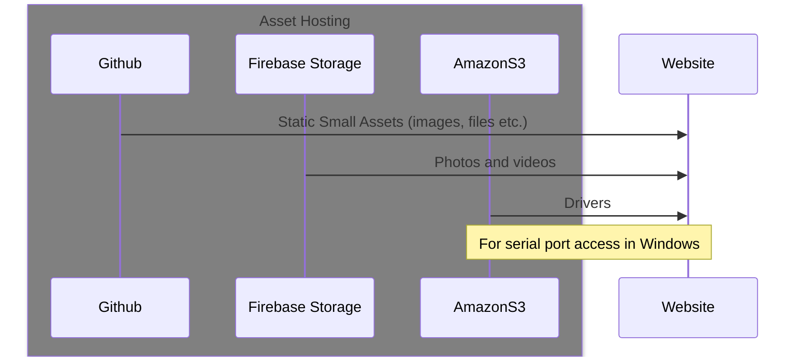

# Datta + Baum Studio

The Studio's public facing website.

Public Facing: [dattabaumstudio.com](https://www.dattabaumstudio.com/)

For Testing and unlinked: [dattabaumstudio.vercel.app](https://dattabaumstudio.vercel.app/)

---

🌐 Built with [Astro](https://astro.build/) and [TailwindCSS](https://tailwindcss.com/) and hosted in (Linked To) [Vercel](https://vercel.com/dev-datta-baum-studio)

📒 What changed and why is logged in [LOG.md](/LOG.md).

## ⚖️ Editing policy pages

The policy pages are written in markdown and can be found:

1. [Terms](/src/pages/terms.md)
2. [Privacy](/src/pages/privacy.md)
3. [Returns](/src/pages/returns.md)
4. [Disclaimer](/src/pages/disclaimer.md)

## ✍🏼 Editing other content

1. Most of the other content is either inline in code or as JavaScript Objects.
2. When editing any of these care must be taken to ensure that the content is **Valid HTML / JavaScript**.
3. This includes there aren't any syntax errors, missing closing tags, etc. It's best to use a code editor with syntax highlighting and linting, instead of editing directly on GitHub.

## 🛒 Store (closed)

The Shopify store is closed. The "Get in touch" buttons on the watch page link to the [contact page](/src/pages/contact.astro). The Cart link in the header is still shown but does nothing.

The old store code is still in the repo, unused:

1. [Cart page](/src/pages/cart.astro) and [Cart component](/src/components/Cart.tsx)
2. [Strap size picker](/src/components/BandSize.tsx) and [its button](/src/components/watch/BandSizeButton.tsx)
3. [Shopify product API route](/src/pages/api/shopify/product.ts)

The waiting list is switched off too. Its [form](/src/components/WaitingList.tsx) and [API route](/src/pages/api/join/index.ts) are still in the repo, unused. The route saves sign-ups to the Firebase Realtime Database, which is why the `FIREBASE_*` env vars are still set in Vercel.

## 💾 Where is the content stored?

- Photos and videos are stored in Firebase Storage. The site gets the storage URL from the `PUBLIC_FIREBASE_STORAGE_URL` env variable, see [constants.ts](/src/constants.ts).
- A few small SVGs are in the [assets/images](/src/assets/images) folder.
- Content for the main pages is as follows:

1. [Home](/src/pages/index.astro)
   - [Marquee](/src/components/HeroMarquee.tsx) (_Commented out for now_)
2. [About](/src/pages/about.astro)
3. [Contact](/src/pages/contact.astro)
4. [Watch](/src/pages/watch/index.astro)
   - [Watch Section](/src/components/watch/WatchSection.astro)
   - [Craftsmanship Section](/src/components/watch/CraftsmanshipSection.astro)
   - [Specs Section](/src/components/watch/SpecsSection.astro)
5. [FAQ](/src/pages/watch/faq.astro)
   - [Reset Time Using Serial](/src/components/watch/ResetTimeUsingSerial.astro)
   - [Reset Time Using Button](/src/components/watch/ResetTimeUsingButton.astro)

## 🔌 What's connected to what ... 🧐 ??

## 👨🏻‍💻 Deployment

- The site is automatically deployed in [Vercel](https://vercel.com/dev-datta-baum-studio/dattabaumstudio-com) on every push to the `main` branch.
- To create preview deployments before making it live, create a new branch, push to it and then create a pull request to `main`.
- This will create a preview deployment that can be shared with others.
- Once satified with the changes, merge the pull request into `main` to make it live.

**Note:** Use the same email in github & vercel.
